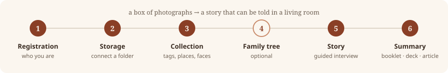
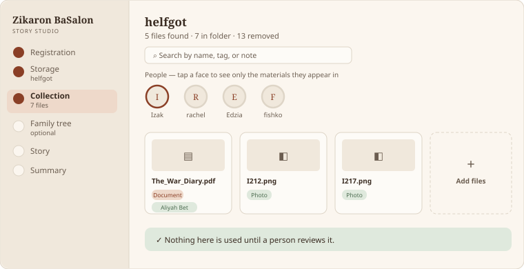
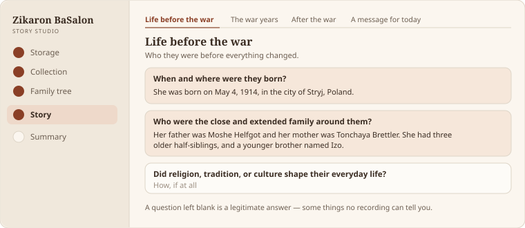
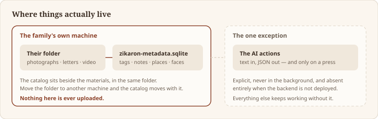

# Zikaron BaSalon — Story Studio

A tool for families gathering a Holocaust survivor's story, and for the hosts who present
it at a Zikaron BaSalon evening.

**Live:** [zikaronbasalon-story-studio.web.app](https://zikaronbasalon-story-studio.web.app)
· [Hebrew](https://zikaronbasalon-story-studio.web.app/he)
· [Guide](https://zikaronbasalon-story-studio.web.app/he/tutorial)

Most families have material — photographs, letters, a scanned diary, a recording someone
made years ago — but no story. The Studio walks that pile through six steps until it is
something that can be told in a living room, and then makes a printable booklet, a
presentation and an article out of it.



> **The material never leaves the family's machine.** The Studio reads files from a folder
> the person picks and writes its metadata to `zikaron-metadata.sqlite` in that same
> folder, beside the materials. No photograph, document or recording is uploaded.

---

## The six steps

| Step | What happens |
| --- | --- |
| **Registration** | Who you are: family member, host, or organisation staff. |
| **Storage** | Connect the folder the material already lives in, or a Google Drive folder. |
| **Collection** | Tag, annotate and place each item. Find and name faces. Read a PDF's text. |
| **Family tree** | Who is related to whom. Optional — import GEDCOM, or build from tagged faces. |
| **Story** | A guided interview: five sections of questions, plus events. |
| **Summary** | Everything in one place, and three things to make from it. |



*Collection, with the Helfgott family's folder connected — the worked example published
in [`examples/helfgot-open/`](examples/helfgot-open/).*



*The guided interview. An answered question is tinted; a blank one is a legitimate
answer, because some things no recording can tell you.*

Alongside the wizard: a **Presentation** side with worked examples from the
organisation's own recorded testimony, a **Catalog** of everything gathered, the
organisation's published **kits**, and an in-app **tutorial**.

---

## Running it

```bash
# the web app
cd app
npm install
cp .env.example .env.local      # fill in from the Firebase console
npm run dev

# the AI functions (optional — the app detects their absence and carries on)
cd functions
npm install
cp .env.example .env.local      # needs a model API key
npm run serve
```

The app works without the Functions backend. Everything that runs on the device —
reading a PDF's text, finding faces, tags, notes, places, the family tree, the catalog,
export and import — keeps working; the AI actions explain that they are not switched on.

### Deploying

```bash
node scripts/release.mjs          # build, deploy, bump the build number, write the changelog
node scripts/release.mjs --dry-run
```

The build number, the release notes and the deployment log can only move together, so a
changelog never describes a release that did not ship. See [`docs/RELEASES.md`](docs/RELEASES.md).

---

## How it is built

- **`app/`** — Vite + React + TypeScript. No CSS framework: design tokens as custom
  properties in `app/src/index.css`, inline styles elsewhere.
- **`functions/`** — Firebase Cloud Functions (Express) for the AI actions. Text in,
  JSON out.
- **`scripts/`** — release, catalog, testimony segmentation, the unpack helper shipped
  with an export.
- **`docs/`** — release history, deployment log, the translation catalog, plans.

### Things worth knowing before changing anything

- **Local storage is a real SQLite file**, not a browser database. `sql.js` in a worker,
  written back through the File System Access API. Every operation is serialised —
  overlapping whole-file writes lost data, and `createWritable()` truncates on open.
- **The metadata file lives with the materials.** Move the folder to another machine and
  the catalog moves with it.
- **Two languages, chosen by URL.** Everything under `/he` is Hebrew, through a router
  basename rather than a route segment. See below.
- **AI is optional by design.** `app/src/lib/aiAvailability.ts` probes `/api/health` and
  validates the JSON body — the SPA rewrite answers `200 text/html` for a missing API, so
  a status check alone would be wrong.

---

## Translation

All interface text lives in `app/src/i18n/locales/` — one JSON file per language, keyed
by the English string itself. Translating means editing data, not code.

```
app/src/i18n/locales/he.json      Hebrew
app/src/i18n/locales/en.json      English (empty: the keys are already English)
```

Adding a language is one new file plus three lines of code. Nothing in any component
changes. [`docs/i18n/README.md`](docs/i18n/README.md) explains the workflow;
[`docs/i18n/TRANSLATION.md`](docs/i18n/TRANSLATION.md) lists every string in the site with
the screen it appears on.

```bash
node scripts/i18n-catalog.mjs           # rebuild the catalog
node scripts/i18n-catalog.mjs --check   # exit non-zero if a language has gaps
```

The catalog separates three kinds of gap, which turn out to be very different problems:
never translated; translated but the component still prints English; and left over from
text that no longer exists.

---

## Reporting issues from inside the app

The Studio carries a reviewing tool: point at any part of a page and describe what is
wrong with it. It is off by default — open any page with `?report=1`, or switch it on
from the version panel. Reports stay in the reviewer's browser until they export them,
as a Markdown list or as JSON. See [`docs/REVIEWING.md`](docs/REVIEWING.md).

It reports and never changes the page. That limit is deliberate: what is on screen is
somebody's family testimony, and a tool that rewrote the page underneath it would make a
reviewer's note indistinguishable from the record.

---

## Privacy and what is in this repository



This repository holds the **software**. It does not hold any family's materials.

- A family's photographs, documents and recordings stay in their own folder, on their own
  machine, and are never uploaded by the app.
- `resources/stories/` — survivor testimony video used in local development — is
  gitignored. It is third-party, rights-restricted material: fetch it locally, never
  publish it.
- `*.sqlite` is gitignored, so no family's catalog is ever committed by accident.
- Secrets live in `.env.local` files, which are gitignored. `.env.example` files are the
  tracked templates. See [`SECURITY.md`](SECURITY.md).

The kits under `app/public/resources/` are Zikaron BaSalon's own published materials,
included here because the site serves them.

### The one exception: `examples/helfgot-open/`

One complete catalog **is** published here, so that the tool can be understood rather
than only described: the Helfgott family's, with their agreement. It is a separate,
redacted copy — not the family's working catalog — and says so inside the SQLite file
itself (`studio_meta.catalog_kind = 'public-example'`). One material, a recording of a
living relative, was removed before publication along with its catalog row, thumbnail
and transcript. See [`examples/helfgot-open/README.md`](examples/helfgot-open/README.md).

Those materials are **not** covered by the code licence. They belong to the family.

---

## Licence

[Apache 2.0](LICENSE) for the code.

The organisation's published kits, the survivor testimony and any family material are
**not** covered by that licence. They belong to Zikaron BaSalon and to the families, and
are used here with their permission.
